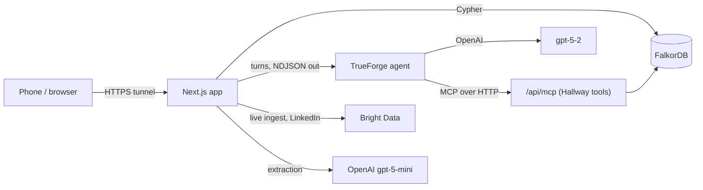

# Architecture

How Hallway works: the product flow, the graph, the data pipeline, the agent and the security
model. Setup is in the [README](../README.md).

## Overview



Everything runs on one machine. Only the Next.js app is exposed (through a Cloudflare quick tunnel
for phones); FalkorDB and TrueForge stay on localhost. The tunnel blocks SSE, so every streaming
route sends NDJSON over a chunked response.

| Package | Role |
| --- | --- |
| `apps/web` | Next.js App Router PWA: screens, API routes, onboarding step machine, agent glue, MCP server |
| `packages/types` | The zod contract: graph nodes and edges, snapshots, every API request and response |
| `packages/graph` | FalkorDB client, seed, `upsertSnapshot`, calendar helpers and all queries. All Cypher lives here, parameterised |
| `packages/ingest` | Bright Data client and budget guard, Universe normalisers, live conference ingest, profile fetchers |

## Product flow

### Onboarding

`POST /api/chat` is a deterministic step machine (`apps/web/lib/onboarding.ts`): conference →
goals → identity → confirm. It works with chips alone; the LLM (`gpt-5-mini`) only reads free text.

1. **Conference.** Chips for ingested conferences. Any other name or URL starts a [live ingest](#live-ingest)
   and the chat streams its progress.
2. **Goals.** Multi-select chips, or free text through one fixed classification prompt that returns
   goals and topics (topics restricted to ones in the graph). Only the parsed result is stored.
3. **Identity.** A LinkedIn URL (Bright Data profiles dataset), a GitHub username (REST + GraphQL,
   including the contribution heatmap), free text, or the demo profile.
4. **Confirm.** A profile card; saving writes the profile to the graph and sets the identity cookie.

### Tabs

| Tab | What it shows |
| --- | --- |
| My Feed | A one-day calendar with a day switcher (sessions, side events, accepted meetings, Google Calendar busy time), clash outlines, confirmed cards, requests sent, suggestions |
| People | A swipe deck ranked by graph signals; tags filter it, swipes re-rank it ([swipe learning](#swipe-learning)) |
| Explore | Side events near the conference, ranked; add to calendar opens the Luma registration page |
| Agenda | **Now:** sessions by priority with add/remove and clash warnings. **Past:** the user's history as a graph (`@falkordb/canvas`) |

Every recommendation carries a `GraphPath`, shown behind an "N hops" chip.

### Invites

A right swipe opens an invite sheet prefilled by `GET /api/invites/suggest`: up to three free
30-minute slots in conference hours (avoiding the user's calendar and the person's talks), a place
and a note. Sending creates a pending `Meeting` and a link the user shares themselves. The invitee
opens `/invite/<token>`, picks a slot and accepts or declines; only then does the meeting appear in
the requester's calendar. Tokens are 128-bit random and stored hashed; a request can be answered once.

### Agent

The chat button opens **Ask Hallway**: a TrueForge agent (`openai/gpt-5-2`) whose tools are served by
the app itself at `/api/mcp` (MCP streamable HTTP, stateless, guarded by `MCP_HALLWAY_TOKEN`).

| Tool | Does | Approval |
| --- | --- | --- |
| `suggest_people` | Ranked people to meet, with reasons and where to find them | |
| `plan_sessions` | Ranked sessions, filterable by text and day, with clash flags | |
| `suggest_explore` | Ranked side events | |
| `check_calendar` | The user's calendar for a day, with clashes | |
| `list_conferences` | Ingested conferences | |
| `start_conference_ingest` / `get_ingest_status` | Live ingest of another conference | |
| `add_to_calendar` | Adds a session or side event | required |
| `create_invite` | Creates a pending meeting and its invite link | required |

`apps/web/lib/agent/trueforge.ts` registers the MCP server once per process, keeps one TrueForge
session per chat cookie and user, and maps TrueForge events to the app's `ChatEvent` stream. Tools
are preloaded (so approvals match by name). A tool that needs approval ends the turn with
`approval_required`; the chat shows the exact action in a sheet, and `POST /api/agent/approve`
resumes with the user's decision.

## Graph

Every node has a stable string id (`<kind>:<key>`); edge ids are `${from}|${TYPE}|${to}`. Labels and
relationship types are validated against zod enums before use. The full schema is in
`packages/types/src/{nodes,edges}.ts`.

```
(Talk)-[:PART_OF]->(Conference)        (SideEvent)-[:NEAR]->(Conference)
(Person)-[:SPEAKS_AT]->(Talk)          (Person)-[:GAVE]->(PastTalk)   (Talk)-[:SIMILAR_TO {score}]->(PastTalk)
(Person|Company)-[:HOSTS]->(SideEvent) (Person)-[:WORKS_AT|WORKED_AT]->(Company)
(Person|Company)-[:OWNS]->(Repo)-[:DEPENDS_ON]->(Package)<-[:MAINTAINS]-(Person)
(Person)-[:SKILLED_IN]->(Skill)        (Company)-[:HIRING_FOR]->(Skill)
(Talk)-[:ABOUT]->(Topic)               (Person)-[:INTERESTED_IN]->(Topic)

// written by the user's actions
(Person)-[:TARGETS]->(Conference)      (Person)-[:HAS_GOAL]->(Goal)
(Person)-[:PLANS]->(Talk|SideEvent)    (Person)-[:SWIPED {dir}]->(Person)
(Person)-[:PREFERS {weight}]->(Topic|Skill|Company|Goal)
(Person)-[:ORGANIZES]->(Meeting)-[:WITH]->(Person)
(Person)-[:MET]->(Person)
```

### Queries

| Query | File | Walk |
| --- | --- | --- |
| People deck | `queries/people.ts` | One query per signal (shared dependency, shared topic, goal match via `HIRING_FOR`, ex-colleague, speaker at a planned talk), merged and scored in TypeScript |
| Session priority | `queries/agenda.ts` | Talks of the target conference, scored by topic match, a goal boost and `PREFERS` weights, with a rerun flag from `SIMILAR_TO` |
| Explore | `queries/explore.ts` | Side events `NEAR` the conference, scored by preferences and host fit |
| Calendar and clashes | `calendar.ts` | `PLANS` targets and accepted meetings; interval overlap and free-slot search in TypeScript |
| Feed, requests sent, Past graph | `queries/feed.ts`, `queries/invites.ts` | The user's confirmed items, organised meetings, and their subgraph (capped at 200 nodes) |

Each query has a vitest test against `data/fixtures`, including its path.

### Swipe learning

A candidate's score is `Σ signalWeight × (1 + PREFERS(me, feature))` over their features. A right
swipe adds +0.2 to each of the candidate's features (topics, skills, company, matched goal), a left
swipe −0.1, clamped to [−1, 2]. Because the weights are edges, the Past graph shows why the ranking
changed.

### Seed and runtime writes

`pnpm seed` merges `data/clean/*.json` and `data/live/*.json` (or `data/fixtures` when there is no
clean data) into `<graph>_next`, carries over every user's runtime subgraph (their profile and
activity edges and the nodes those reach), then atomically `RENAME`s it into place. Other packages
write only through `upsertSnapshot`, which merges by id without wiping.

## Data

### Universe snapshot

GitHub Universe 2026 is pre-ingested and committed in `data/clean/`, so it never waits on a scraper.
`pnpm --filter @hallway/ingest sample:*` pulls raw records through Bright Data into `data/raw/`
(gitignored); `pnpm --filter @hallway/ingest normalise` turns them into validated `GraphSnapshot`
files, and `pnpm ingest:check` validates the result:

| Data | Source |
| --- | --- |
| Sessions, speakers, times | Universe catalog via Web Unlocker |
| Speaker profiles | LinkedIn profiles dataset |
| Past talks (rerun tag) | YouTube videos dataset, matched by embeddings (cosine > 0.8) |
| Hiring | LinkedIn jobs dataset |
| Side events | Luma pages via Web Unlocker (public event data and hosts only) |

A missing session end is set to start + 45 minutes (+ 90 for workshops).

### Live ingest

`POST /api/conferences` (or the onboarding chat, or the agent) starts one in-process job;
`GET /api/conferences/jobs/<id>` reports its stage and counts. `packages/ingest/src/live.ts` runs:

1. **Find.** A web search through the Unlocker; `gpt-5-mini` picks the official site, then reads the
   name, dates, city, venue, time zone and agenda URL from it.
2. **Sessions.** Timed JSON-LD events when the page has them, otherwise `gpt-5-mini` extraction of the
   page text (JavaScript-only pages are refetched rendered). Up to 150.
3. **Side events.** The Luma page for the city, filtered to the conference dates ±1 day in venue time.
   Up to 30.
4. **Write.** A validated snapshot is saved to `data/live/<conf>.json` (gitignored, so reseeds keep it),
   upserted, and talks that disappeared since a previous read are pruned.

A conference with no readable sessions fails without saving anything. Jobs are globally rate-limited.

### Budget

Every Bright Data call reserves its cost first through `packages/ingest/src/budget.ts`, a persisted
counter in `data/live/budget.json` capped by `BRIGHTDATA_BUDGET_USD`. Pricing: $1.50 per 1,000
dataset records or Unlocker requests. `pnpm --filter @hallway/ingest budget` prints the spend.

## Security

- **Identity.** "Me" always comes from an httpOnly, HMAC-signed cookie set at onboarding
  (`apps/web/lib/identity.ts`), never from a request body.
- **Agent.** Tools receive a purpose-bound agent key that expires after 12 hours and can't be used as
  the cookie, so the model can't act for another user and its context holds no login token. Calendar
  adds and invites need the user's approval in the app.
- **MCP endpoint.** Reachable through the tunnel, so it requires `MCP_HALLWAY_TOKEN` (timing-safe compare).
- **Costs.** Credit-spending routes (chat, agent, live ingest, suggestions) are rate-limited
  per IP (`apps/web/lib/ratelimit.ts`) and every scrape goes through the budget guard.
- **Privacy.** The graph holds only people public in this context (speakers, hosts, maintainers) and
  users who onboard themselves. The public invite page shows only the requester's name, headline,
  reason and slot.
- **Secrets** come only from `process.env` and are never logged or committed.

## Configuration

All settings are environment variables, documented in [`.env.example`](../.env.example).
`DEMO_CACHE=record` saves LLM and scrape responses to `data/cache/`; `DEMO_CACHE=1` replays them for an
offline-safe demo.
